# Sijill: PDPL readiness for Egypt

**Open-source, self-hosted readiness tracking for Egypt's Personal Data Protection Law (Law No. 151 of 2020).**
*Sijill* (سجل) means "register" or "record", which is what the law asks organisations to keep. The project was
called PDPL-Ready until 18 November 2026.

Assess an organisation against the law, back the technical part with automated evidence from Prowler and Linux
hosts, keep the records the law asks for, run the privacy programme around them (remediation tasks, a risk register,
requests from individuals, vendors, impact assessments, policies), watch the score over time, catch regressions, run
the breach clock, and hand management a report, in English or Arabic.

> Sijill helps you organise evidence and track readiness. It is **not legal advice** and does not determine legal
> compliance. The requirement catalog is plain-language drafting that has **not yet been verified** against the official
> legal texts. Every unverified item is marked in the app and listed in [docs/LEGAL-REVIEW.md](docs/LEGAL-REVIEW.md).


## Why it exists

Egypt's data protection regime has moved from principle to enforcement. Controllers and processors are expected to
appoint a Data Protection Officer, hold licences and permits for some activities, keep records of processing, and
report breaches to the regulator quickly. Commercial GRC platforms cost more than most small organisations can spend
and centre on SOC 2, ISO 27001 and GDPR, so in practice compliance lives in spreadsheets and PDF checklists, with no
proof that the technical controls exist or still hold.

**Who it is for**

- **Compliance consultants and DPOs serving several small organisations**: clinics, schools, ed-tech companies,
  startups. One install holds every client, each organisation's data kept separate, with a Clients page that ranks
  them side by side.
- **In-house IT and security teams** who have to show that the safeguards are actually in place.

## What it does

| | Capability | What you get |
|---|---|---|
| 1 | **Assessment workflow** | 11 areas, 52 requirements, each with a plain-language question in English and Arabic; answer, add notes, attach evidence (hashed), see the score and gaps move |
| 2 | **Records of processing** | The processing register with completeness hints, exported in controller and processor layouts (CSV with bilingual headers, PDF in English or Arabic) |
| 3 | **Licences and obligations** | An applicability screener, a licensing questionnaire that says "likely required", and a tracker for licences, permits, DPO registration, consent mechanisms and cross-border flows, with renewal reminders on the dashboard |
| 4 | **Technical evidence engine** | Imports Prowler JSON-OCSF findings and the output of a dependency-free Linux collector; 129 Prowler AWS checks and 12 Linux checks mapped to 16 technical requirements; every result hashed and timestamped |
| 5 | **Posture and drift** | Scheduled collection, run history, resource-by-resource comparison, regression detection, score over time |
| 6 | **Breach readiness** | Incident records with live countdowns to the regulator deadline and the notice to individuals, escalation as the deadline nears, a timeline, and notices filled from the recorded facts (EN/AR, text and PDF) |
| 7 | **Reporting** | Readiness report and gap list (PDF in English and shaped right-to-left Arabic, CSV), evidence pack with a SHA-256 manifest, OSCAL catalog, assessment results and POA&M |
| 8 | **Remediation** | Tasks with owners, priorities and due dates, created from any gap in one click; open tasks become the POA&M milestones (owner, due date, status) and a section of the PDF report |
| 9 | **Risk register** | Likelihood × impact on 1–5 scales, inherent and residual scores, a 5×5 heat map, treatment, links to requirements; accepting a risk is an Admin decision with a written reason and an expiry date (at most a year), and expired acceptances are flagged |
| 10 | **Requests from individuals** | Access, correction, deletion, objection, consent withdrawal and portable-copy requests, each with a response clock (configurable, marked as an unverified placeholder), identity-check status, and on-time/late outcome |
| 11 | **Vendors and processors** | Who handles personal data for you, whether a data processing agreement is signed, when safeguards were last checked, data held outside Egypt, next review |
| 12 | **Impact assessments** | DPIAs linked to processing activities, with an eight-criterion screening ("likely needed" at two or more), necessity, risks, measures, residual risk and DPO opinion; an Admin approves only a complete assessment |
| 13 | **Policy library** | Versioned policies with owners, linked requirements and evidence, approval history and review dates; a new version needs approval again |
| 14 | **Several client organisations** | One install, many clients: each organisation has its own assessment, evidence, registers, governance records and reports; a switcher in the sidebar; a Clients page with every client's readiness, evidence split, gaps, high risks, overdue items, missing contracts and breach clocks; per-account access to chosen organisations |
| 15 | **Evidence requests** | Pick requirements, get a private link and send it to whoever at the client knows the answer (IT vendor, HR, clinic manager). They answer in English or Arabic and attach files without an account; nothing counts until you accept it, and accepted files become evidence on the requirement, credited to the sender. Links are random, stored only as a hash, expire, and can be replaced or revoked |

Everything runs in English and Arabic with full right-to-left layout, behind local accounts with four roles
(Admin, DPO, IT/Security, read-only Auditor) enforced on the server, optional two-step sign-in with an authenticator
app (TOTP), and an append-only, hash-chained audit log. The dashboard shows the governance picture next to the score
(open and overdue tasks, the risk heat map, overdue requests, processors without a contract, policies overdue for
review), and every requirement's drill-down lists the tasks, risks and policies linked to it.
All AWS evidence in this repository is synthetic: no AWS account was scanned.

## Screenshots

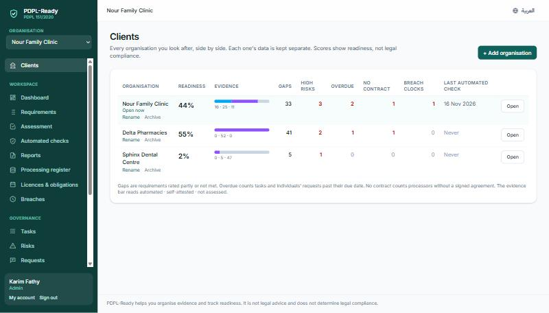

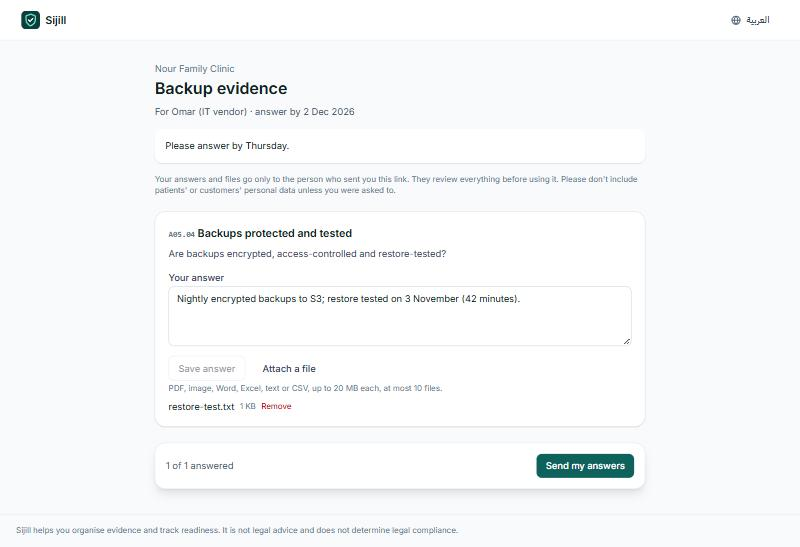

All data below is the fictional demo clinic that `scripts/start.ps1` seeds.

| | |
|---|---|
| 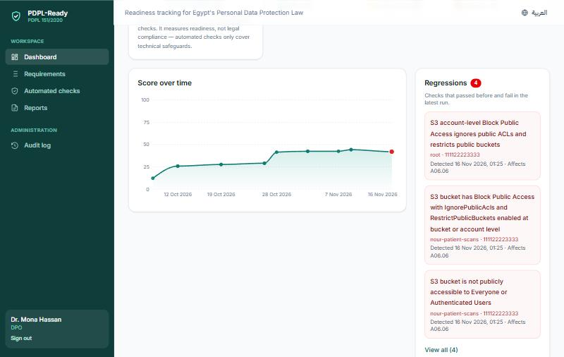 |  |
| **Drift.** The latest scan dipped the score; the red point and the list show why. | **Every number explains itself.** The DPO answered "Met"; three failing checks cap it at "Partly met". |
| 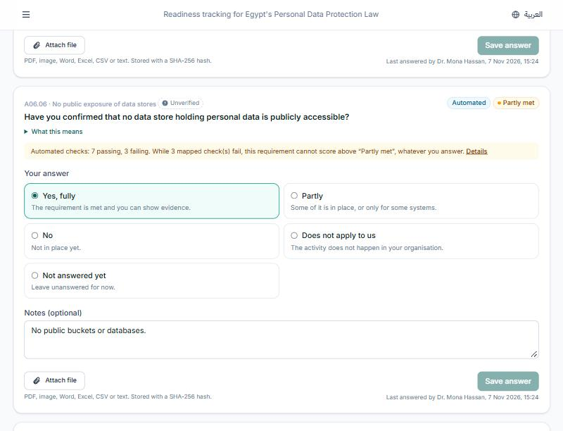 |  |
| **Assessment.** Plain-language questions; the answer is warned that failing checks will cap it. | **Run comparison.** Resource-by-resource diff against the previous scan of the same account. |
|  | 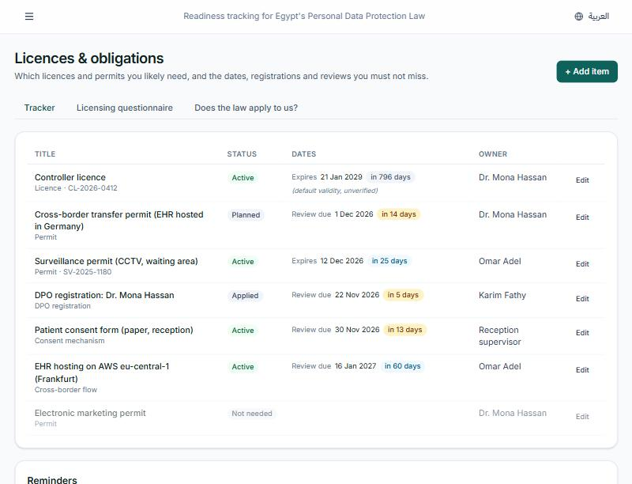 |
| **Breach clock.** Live countdowns from the moment of awareness, and the regulator notice filled from the incident. | **Obligations.** Licences, permits, DPO registration and reviews, with days left and reminders. |
| 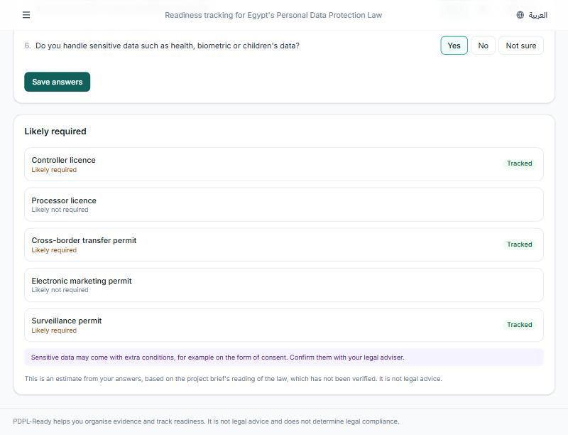 | 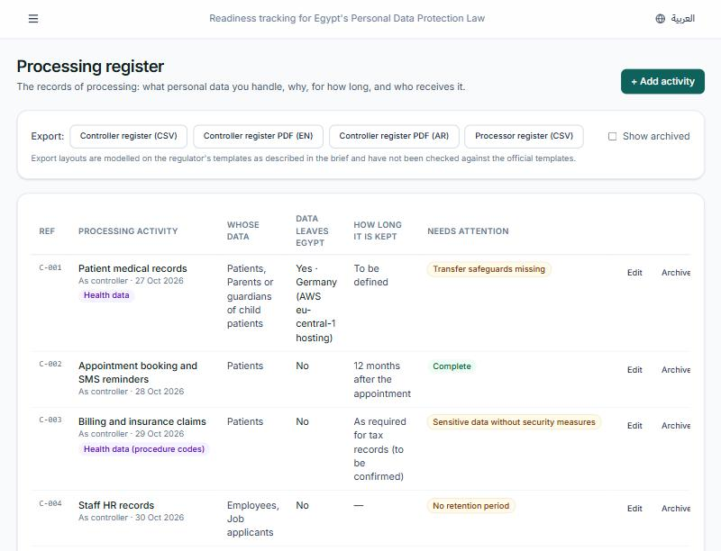 |
| **Licensing.** "Likely required", never "required", with the estimate disclaimer. | **Register.** Completeness hints in plain language, exports in two layouts. |
|  |  |
| **Arabic, right to left.** Mirrored layout, Arabic-Indic digits, reversed time axis. | **Arabic PDF.** Shaped and reordered with pure-Python packages, no system fonts. |
|  | 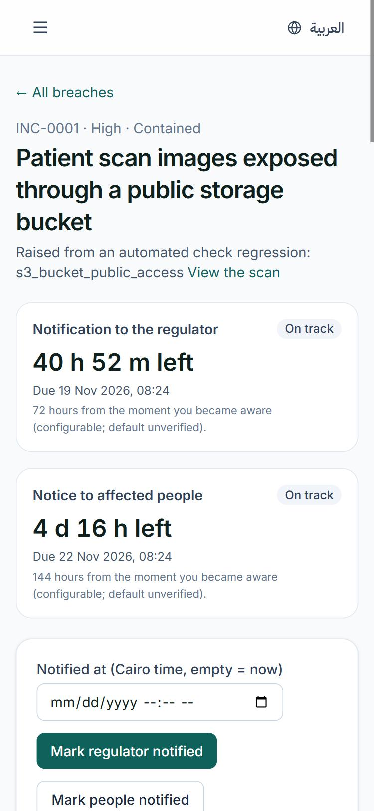 |
| **Reports.** PDF, CSV, ZIP and OSCAL, each with the not-legal-advice notice. | **On a phone.** Every screen was checked at 375 px for overflow. |
|  | 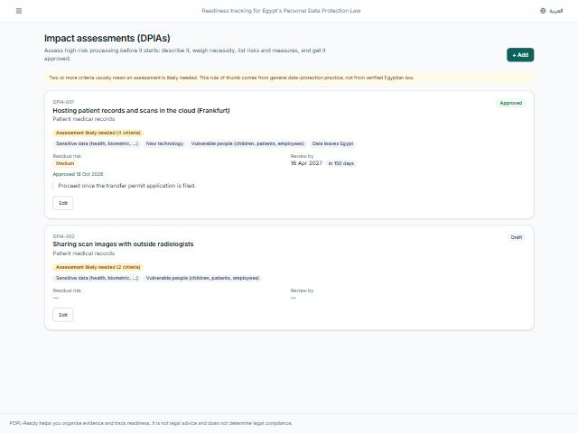 |
| **Risk register.** Heat map, inherent and residual scores, and a time-limited acceptance signed off by an Admin. | **DPIAs.** Screening criteria, "likely needed" at two or more, approval only once the DPO opinion and residual risk are in. |
| 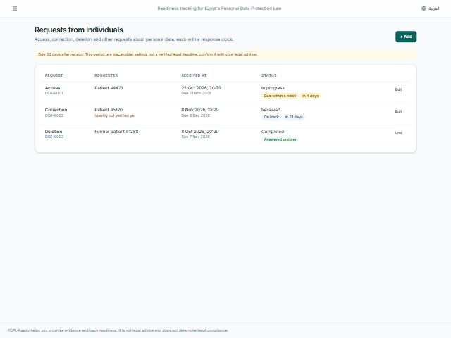 | |
| **Requests from individuals.** Each request has a clock; the period is a setting flagged as unverified. | |

## Architecture

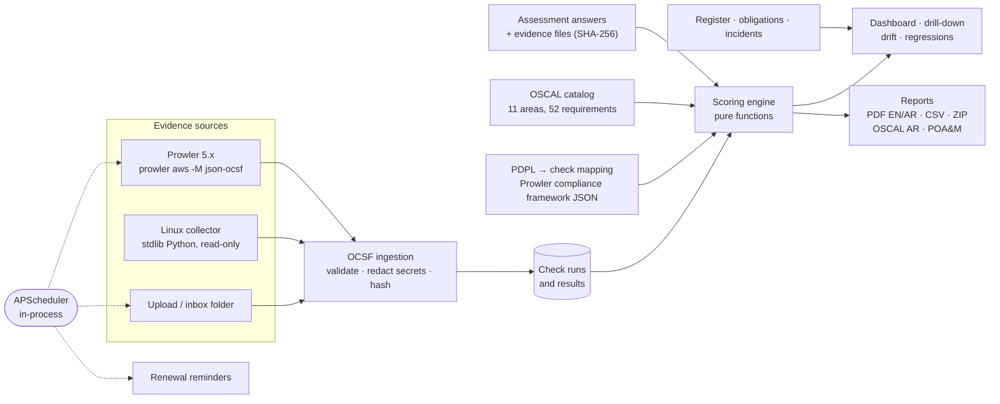

- **Backend**: Python 3.12, FastAPI, SQLAlchemy 2 + Alembic, Pydantic, APScheduler. SQLite by default; Postgres via
  `DATABASE_URL` (exercised in CI).
- **Frontend**: React 19, TypeScript, Vite, Tailwind CSS 4, Recharts, i18next. FastAPI serves the built UI, so the app
  is one process on one port.
- **Data contract**: OSCAL 1.1.3 for the catalog, assessment results and POA&M, validated against the official NIST
  JSON schemas vendored in `backend/app/oscal/schemas/`.

## How the PDPL-to-check mapping works

The law's requirements live in [`catalog/pdpl-catalog.json`](catalog/pdpl-catalog.json), an OSCAL catalog with one
group per assessment area and one control per requirement. Each control carries its Arabic text, a weight (1-5),
whether it is a technical or organisational requirement, and `verified=false` / `source-status=needed` until a lawyer
reviews it.

The technical requirements are mapped to automated checks in
[`compliance/prowler/pdpl_egypt_aws.json`](compliance/prowler/pdpl_egypt_aws.json), written as a **Prowler compliance
framework** so it can be contributed upstream (see [docs/PROWLER-UPSTREAM.md](docs/PROWLER-UPSTREAM.md)). The format
was read from the Prowler 5.50.0 package itself, not written from memory, and the file loads with Prowler's own
`load_compliance_framework`. Every check ID is verified by a test against a committed snapshot of Prowler 5.50.0's
678 AWS checks, and again against a live Prowler install in CI.

Prowler has no Linux host provider, so [`collectors/linux/pdpl_linux_collector.py`](collectors/linux/pdpl_linux_collector.py)
fills the gap: one file, Python 3.6+ standard library only, read-only (a test parses its source and fails if it ever
runs a command outside an allow-list of read-only invocations). It checks disk encryption, SSH configuration, auditd and
its rules, log retention, time sync, the host firewall, pending security updates, automatic updates and permissions on
sensitive files, and prints findings in the same OCSF shape as Prowler. Its mapping
([`compliance/linux/pdpl_egypt_linux.json`](compliance/linux/pdpl_egypt_linux.json)) uses the same framework schema.

```
sudo python3 pdpl_linux_collector.py -o $(hostname).ocsf.json   # then import the file, or drop it in the inbox
```

| Technical requirement | AWS checks | Linux checks |
|---|---|---|
| A05.03 Retention periods enforced | 1 | – |
| A05.04 Backups protected and tested | 9 | – |
| A06.01 Encryption at rest | 15 | 1 |
| A06.02 Encryption in transit | 11 | 1 |
| A06.03 Key management | 5 | – |
| A06.04 Least privilege | 10 | – |
| A06.05 Strong authentication | 6 | 1 |
| A06.06 No public exposure of data stores | 19 | – |
| A06.07 Network protection | 8 | 1 |
| A06.08 Patching and vulnerability management | 8 | 2 |
| A06.09 Host hardening | 3 | 2 |
| A07.01 Audit logging enabled | 8 | 2 |
| A07.02 Log retention and protection | 7 | 2 |
| A07.03 Threat detection | 7 | – |
| A07.04 Security alerting | 10 | – |
| A07.05 Access to personal data is traceable | 4 | – |

## How scoring works

Each requirement ends up **met**, **partly met**, **not met**, **not applicable** or **not assessed**:

1. A self-attested answer is used as given, **except that a requirement backed by automated checks cannot score above
   "partly met" while any mapped check is failing**, whatever the answer says.
2. Without an answer, automated results decide: all checks passing → met; some failing → partly met; all failing → not met.
   A check fails if any resource fails it (one public bucket fails "no public buckets").
3. "Not applicable" is ignored while a mapped check fails; the systems evidently exist.
4. Evidence older than a configurable age (30 days by default) is flagged **stale**. It is shown, not scored.
5. Met = 1, partly met = 0.5, not met = 0, **not assessed = 0**; not applicable is excluded. Area and overall scores
   are weight-averaged over requirements.

The dashboard always shows how many requirements are backed by **automated evidence**, **self-attested** or **not
assessed**, because automated checks only reach the technical-safeguard part of the law. That is why the headline
number is a *readiness* score and is never presented as legal compliance. Click any area, requirement or regression
to see the answer, each mapped check and each failing resource behind the number. The rules are pure functions in
[`backend/app/scoring.py`](backend/app/scoring.py) with their own unit tests.

## Breach readiness, licences and records

- **Breach clock.** The clock starts when the organisation became aware of the breach. The regulator deadline
  (72 hours by default) and the notice to individuals (a clearly marked placeholder default) are configuration, never
  constants. Clocks escalate under 24 hours and again under 12 hours, and show "Overdue by …" afterwards. Times are
  stored in UTC and shown in Cairo time; tests cover a deadline crossing midnight and Egypt's daylight-saving change.
  The regulator notice and the letter to individuals are filled only from recorded facts; anything missing is marked
  "[to be completed]".
- **Licences and obligations.** The screener says which side of the Central Bank of Egypt line an organisation is on
  (CBE-supervised entities out of scope, except money transfer and currency exchange companies). The licensing
  questionnaire turns six yes/no answers into "likely required" results that can be tracked with one click. Licences
  without an expiry date get the configured default validity, labelled as such.
- **Records of processing.** One entry per activity, as controller or processor, with completeness hints (missing
  retention, transfer safeguards, security measures for sensitive data, …).

## How OSCAL is used

| Document | Endpoint | Contents |
|---|---|---|
| Catalog | `GET /api/catalog/oscal` | The 52 requirements; Arabic in a namespaced part/prop. Admins can import a reviewed catalog (schema-validated first). |
| Assessment results | `GET /api/reports/oscal/assessment-results` | One observation per automated check per monitored system, with every resource result and its SHA-256 as relevant evidence; one observation per self-attested answer; one finding per assessed requirement targeting its assessment objective. |
| Plan of action and milestones | `GET /api/reports/oscal/poam` | One POA&M item per gap, linked to its finding, carrying the remediation owner, due date and status from the linked tasks. |

Exports are validated against the official NIST OSCAL 1.1.3 JSON schemas in the test suite (the schemas use
`\p{L}` patterns, so validation runs with the `regex` package). Round trips are tested: catalog → OSCAL → catalog is
lossless, and an exported assessment-results document imported into an empty install reproduces the same automated
statuses and findings (`POST /api/reports/oscal/assessment-results/import`), so a consultant can carry evidence between
installs.

## Evidence integrity and security

- Every findings file, every individual result and every uploaded evidence file is stored with a **SHA-256** hash and a
  UTC timestamp; downloads re-verify the hash. The evidence pack ships `sha256sums.txt`, checkable with `sha256sum -c`.
- The **audit log** is append-only, enforced three ways: ORM events, database triggers (SQLite and Postgres) and a hash
  chain that `GET /api/audit/verify` recomputes.
- **Cloud credentials are never stored.** The Prowler adapter only passes an AWS profile name or role ARN from the
  server environment. Anything in a findings file that looks like an access key, secret key, session token or private
  key is redacted before storage.
- Optional **two-step sign-in** (RFC 6238 TOTP, 6 digits, 30 s, ±1 step, replay-protected), set up with a QR code on
  *My account*; the password step issues a five-minute token for the code step, failed codes are throttled, and an Admin
  can reset a lost authenticator. Every governance write and approval is in the audit log.
- Argon2 password hashing, signed HttpOnly SameSite=Strict session cookies, a custom header on every write (CSRF),
  login throttling, role checks on every endpoint, strict security headers, upload type, size and magic-byte checks,
  and CSV formula neutralisation.

## Run it

Requirements: Windows with PowerShell, Python 3.12 (64-bit) and Node 24. Everything else installs project-locally.

```powershell
./scripts/start.ps1
```

This creates `.venv`, installs dependencies, builds the UI, migrates the database, seeds the demo clinic on first run
and serves everything at <http://127.0.0.1:8000>. Demo accounts (password `pdpl-demo-2026`):

| User | Role | Can |
|---|---|---|
| `admin` | Admin | everything, including users and settings |
| `dpo` | DPO | answer the assessment, upload evidence, manage the register, obligations and breaches |
| `it` | IT / Security | import findings, run collection, upload evidence, record breaches |
| `auditor` | Auditor | read everything, download reports, change nothing |

Other options:

```powershell
./scripts/start.ps1 -NoDemo                     # empty install: create the first admin in the browser
./scripts/start.ps1 -DataDir D:\clients\acme    # a separate install, if a client needs its own server
./scripts/start.ps1 -ResetDemo                  # wipe and re-seed the demo
./scripts/dev.ps1                               # API with auto-reload + Vite dev server on :5173
```

Configuration is by environment variable (`PDPL_` prefix), for example `PDPL_EVIDENCE_STALE_DAYS`,
`PDPL_COLLECT_INTERVAL_HOURS`, `PDPL_AWS_PROFILE`, `PDPL_BREACH_REGULATOR_HOURS` and `DATABASE_URL`. The Settings
screen lists every value and marks the legal ones unverified; see [docs/LEGAL-REVIEW.md](docs/LEGAL-REVIEW.md).

A `Dockerfile` and `docker-compose.yml` are included (`PDPL_SEED_DEMO=1` seeds the demo). They are built in CI but were
not run on the development machine.

### Collecting evidence

- **Prowler (AWS)**: install Prowler where Sijill runs and set `PDPL_AWS_PROFILE` or `PDPL_AWS_ROLE_ARN`; the
  scheduler then runs `prowler aws --checks <mapped checks> -M json-ocsf` and imports the result. Or run Prowler
  anywhere and import its `.ocsf.json` file.
- **Linux**: run the collector on each host and import the file, or copy it into the inbox folder shown on the
  *Automated checks → Collection* tab.
- **Several organisations**: scheduled collection uses credentials from the server's environment, so it feeds one
  organisation (`PDPL_COLLECT_ORG_ID`, default 1). For the others, import findings files on their *Runs* tab or with
  `python -m app.cli import-findings FILE --org ID`.
- **A real AWS account**: [scripts/aws-lab](scripts/aws-lab/README.md) creates a few deliberately weak, low-cost
  settings in an account you own, scans them read-only with Prowler, imports the result and tears everything down.
- **Try it without any infrastructure**: import `fixtures/prowler/nour-clinic-week6.ocsf.json` or
  `fixtures/linux-output/clinic-web-01.ocsf.json`.

## Tests

| Suite | Count | What it covers |
|---|---|---|
| Backend (pytest) | 237 passed, 2 skipped | evidence request links (token shown once and stored hashed, CSRF header, wrong type and forged content, file limits, expiry, revoke and replace, unknown-token throttling, review before anything reaches the assessment, organisation of the link wins over the browser's), organisation isolation (every module by list and by id, forged organisation cookie, restricted accounts, archived organisations, per-organisation audit trail that still verifies, migration of existing data), auth and every role, two-step sign-in (RFC test vectors, time window, replay, throttling, reset), governance modules (risk bands and acceptance expiry, request clocks, DPIA screening and approval rules, policy versions, vendor gaps, role checks on every module), audit chain, catalog schema and round trip, scoring rules, ingestion edge cases (malformed, wrong class, oversized, wrong type, duplicate), redaction, regressions, adapters, assessment and evidence uploads (wrong type, mismatched content, oversized, tampered file), register, obligations (screener, default expiry, reminders), breach clocks (70 h → urgent, overdue, midnight and DST in Cairo), notice templates, reports, OSCAL validity and round trip, evidence pack hashes, demo story |
| Linux collector | included above | replays recorded fictional hosts; read-only command guarantee |
| Frontend (vitest) | 49 passed | evidence requests (create from a requirement, link shown once, review, the recipient's page in English and Arabic, expired link), clients page, organisation switcher, per-account organisation access, sign-in and the two-step code, account setup with QR, risk acceptance, request clocks, DPIA screening, policy approval, task prefill from a gap, roles, Arabic RTL and digits, dashboard, drill-down, filters, import errors, assessment, register, obligations, breach clocks and templates |

The two skipped tests need a live Prowler install, which the Windows path limit prevented here (see
[docs/DECISIONS.md](docs/DECISIONS.md)); CI's `prowler-mapping` job runs them on Linux. Postgres tests and the Docker
build also run only in CI. Every screen was also checked in the running app for unlabelled controls, unnamed buttons,
duplicate ids and horizontal overflow, in English and Arabic and at 375 px width.

```powershell
cd backend; ..\.venv\Scripts\python -m pytest
cd frontend; npm test
```

Measured on the development machine: from a fresh clone, `scripts/start.ps1` was serving after 80 seconds (with pip and npm caches already warm); seeding the demo takes 2.1 seconds; the readiness PDF renders
in about 0.04 s in English and 0.2 s in Arabic; the evidence pack (116 KB) builds in 0.08 s; the OSCAL
assessment-results export holds 153 observations and 41 findings.

## Project layout

```
backend/app/          FastAPI app: auth, catalog, evidence engine, scoring, posture, reports, register,
                      obligations, incidents, scheduler
backend/alembic/      database migrations (append-only audit triggers included)
catalog/              the PDPL OSCAL catalog
compliance/           PDPL mapping as a Prowler framework (AWS) and the Linux mapping; Prowler check snapshot
collectors/linux/     the read-only Linux collector
fixtures/             recorded fictional hosts and synthetic Prowler findings
frontend/             React + TypeScript UI
scripts/              start, dev, fixture, font and legal-review generators; aws-lab (real-account test lab)
docs/                 DECISIONS, PROGRESS, LEGAL-REVIEW, PROWLER-UPSTREAM, screenshots
```

## Legal accuracy

Invented legal detail is worse than a visible gap, so:

- No article numbers, decree clauses, fees or penalties appear anywhere (a test enforces it for the catalog).
- Every requirement is marked unverified with "source needed" until a lawyer reviews it; reviewing means editing the
  catalog (or importing a reviewed one) and citing the source.
- Deadlines and durations are configuration with defaults.
- Licences and permits are described as "likely required", never "required".
- The UI footer and every report carry the not-legal-advice notice.

## License

MIT, see [LICENSE](LICENSE). Bundled schemas, fonts and Prowler metadata keep their own licences.
