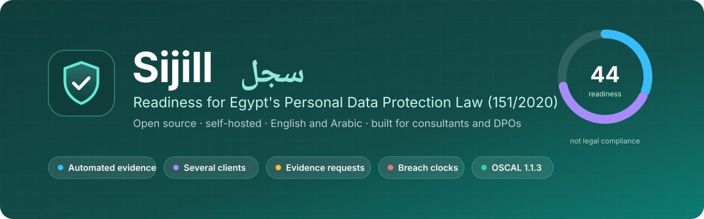
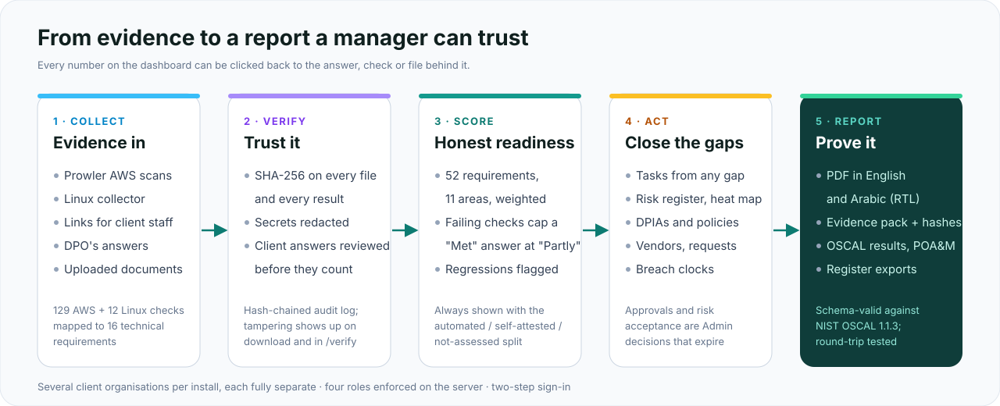
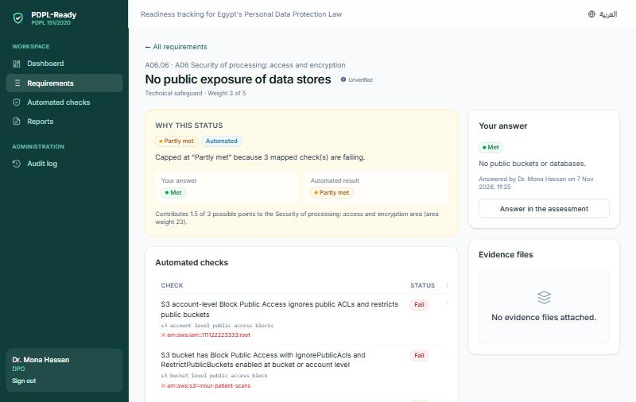
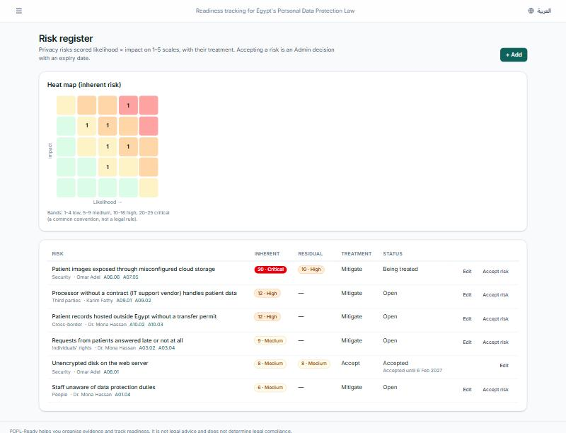
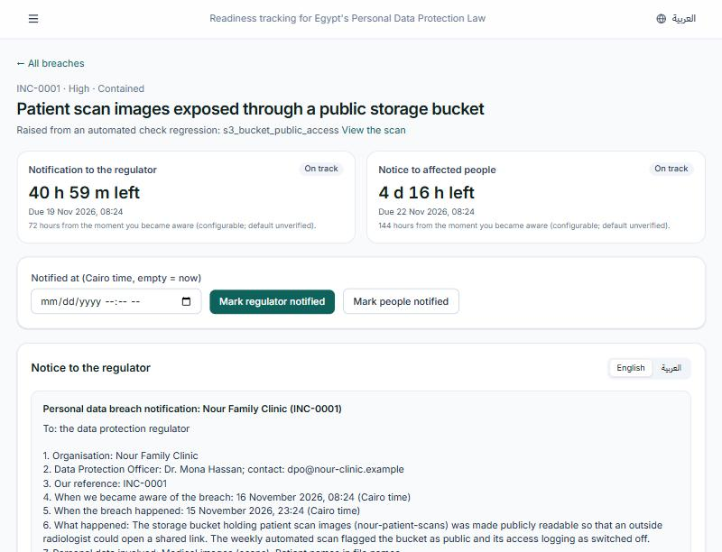
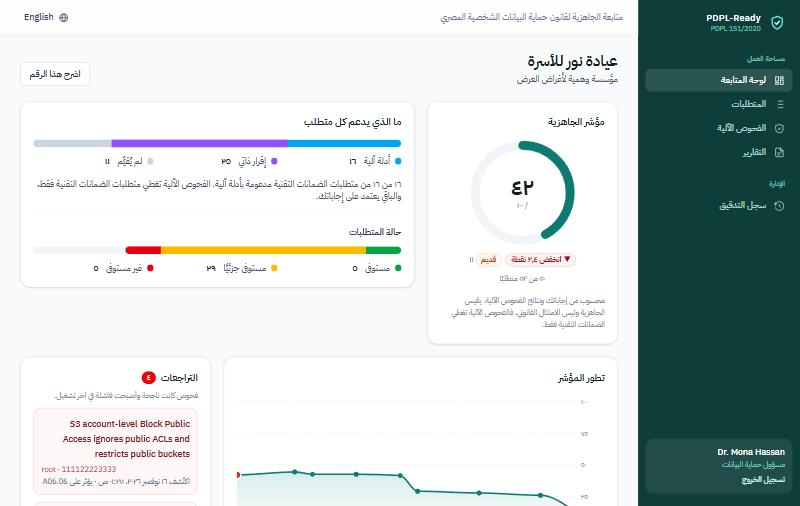
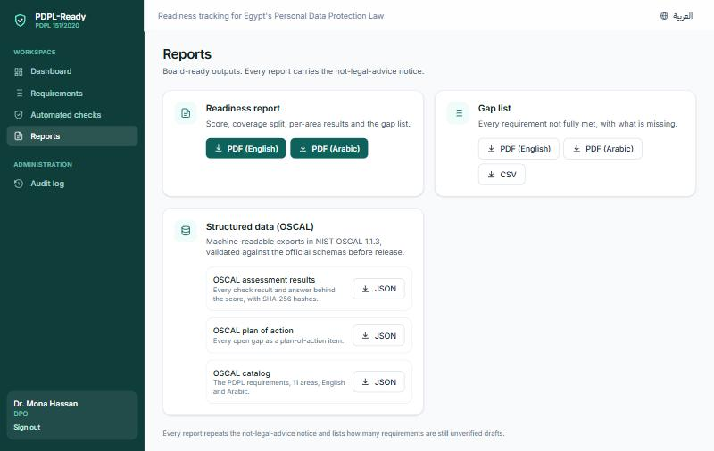
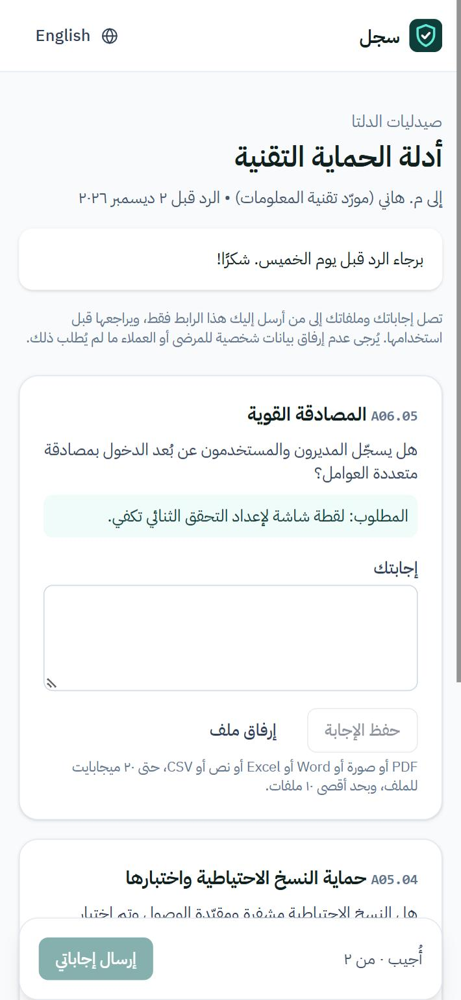
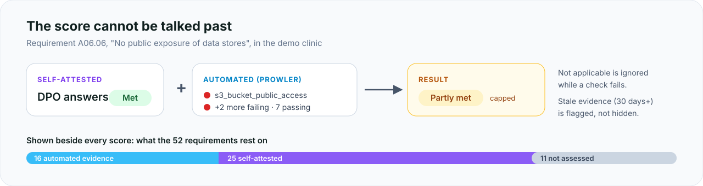
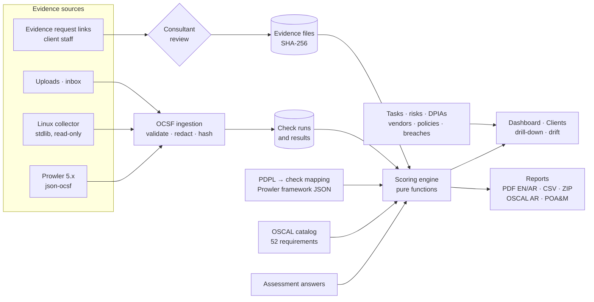

<p align="center">
  
</p>

<p align="center">
  <a href="https://github.com/lumidren/Sijill-/actions/workflows/ci.yml"></a>
  
  
  
  
  
  
</p>

<p align="center">
  <b>Open-source, self-hosted readiness platform for Egypt's Personal Data Protection Law (Law No. 151 of 2020).</b><br>
  Assess every client, back the technical part with real scan evidence, run the privacy programme, and hand<br>
  management a report they can trust, in English or Arabic.
</p>

<p align="center">
  <a href="#-what-it-does">Features</a> ·
  <a href="#-a-tour">Tour</a> ·
  <a href="#-how-the-score-works">Scoring</a> ·
  <a href="#-run-it">Run it</a> ·
  <a href="#-architecture">Architecture</a> ·
  <a href="#-under-the-hood">Under the hood</a>
</p>

> [!IMPORTANT]
> Sijill helps you organise evidence and track readiness. It is **not legal advice** and does not determine legal
> compliance. The requirement catalog is plain-language drafting that has **not yet been verified** against the
> official legal texts; every unverified item is marked in the app and listed in [docs/LEGAL-REVIEW.md](docs/LEGAL-REVIEW.md).

<p align="center">
  
</p>

*Sijill* (سجل) means "register" or "record", which is what the law asks organisations to keep.

## 🎯 Why it exists

- **The law is being enforced.** Controllers and processors are expected to appoint a DPO, hold licences for some
  activities, keep records of processing and report breaches to the regulator within hours.
- **The tools don't fit.** Commercial GRC platforms cost more than a small clinic or school can spend and centre on
  SOC 2, ISO 27001 and GDPR. So compliance lives in spreadsheets, with no proof the technical controls still hold.
- **Consultants carry many clients.** A DPO-as-a-service juggles a dozen small organisations, chasing evidence by
  email. Sijill is built around that job, and around the in-house IT teams who have to prove the safeguards exist.

<p align="center">
  
</p>

## ✨ What it does

<table>
<tr>
<td width="33%" valign="top">

**📋 Assess**
- 52 requirements in 11 areas, each a plain-language question in English and Arabic
- Evidence files hashed with SHA-256
- Score with an honest evidence split, gaps ranked by weight

</td>
<td width="33%" valign="top">

**🛰️ Prove**
- Prowler AWS findings (129 checks) and a read-only Linux collector (12 checks)
- Run history, resource-by-resource diffs, regression alerts
- Scheduled collection, secrets redacted on import

</td>
<td width="33%" valign="top">

**🏢 Serve many clients**
- Several organisations in one install, fully separated
- Clients page ranking every client side by side
- Per-account access to chosen organisations

</td>
</tr>
<tr>
<td valign="top">

**✉️ Collect from client staff**
- Private evidence-request links, no account needed
- Answers and files reviewed before they count
- Links hashed, expiring, revocable

</td>
<td valign="top">

**🛠️ Run the programme**
- Tasks from any gap · risk register with heat map
- DPIAs with screening · versioned policies
- Vendors and processors · requests from individuals

</td>
<td valign="top">

**⏱️ Be ready for a breach**
- Live countdowns to the regulator and to affected people
- Notices filled only from recorded facts (EN/AR, PDF)
- Licences, permits and renewal reminders

</td>
</tr>
<tr>
<td valign="top">

**📊 Report**
- Readiness report and gap list: PDF (English and shaped Arabic) and CSV
- Evidence pack ZIP with a SHA-256 manifest
- Register exports in controller and processor layouts

</td>
<td valign="top">

**🧾 Speak OSCAL**
- Catalog, assessment results and POA&M in NIST OSCAL 1.1.3
- Validated against the official schemas
- Round-trip tested, so evidence moves between installs

</td>
<td valign="top">

**🔐 Stay secure**
- Four roles enforced on the server, two-step sign-in (TOTP)
- Append-only, hash-chained audit log
- Argon2, CSRF header, strict headers, upload checks

</td>
</tr>
</table>

## 🧭 A tour

All data is fictional, seeded by `scripts/start.ps1`: Nour Family Clinic, Delta Pharmacies and Sphinx Dental Centre.

<table>
<tr>
<td width="50%"></td>
<td width="50%"></td>
</tr>
<tr>
<td><b>Every client at a glance.</b> Readiness, how it is backed, gaps, high risks, overdue items and answers waiting for review, per organisation.</td>
<td><b>Every number explains itself.</b> The DPO answered "Met"; three failing Prowler checks cap it at "Partly met", with the resource behind each.</td>
</tr>
<tr>
<td></td>
<td></td>
</tr>
<tr>
<td><b>Evidence requests.</b> Client staff answer and attach files from a private link, no account. Nothing counts until the consultant accepts it.</td>
<td><b>Drift.</b> Each scan is compared resource by resource with the previous one; regressions surface on the dashboard.</td>
</tr>
<tr>
<td></td>
<td></td>
</tr>
<tr>
<td><b>Risk register.</b> Likelihood × impact, inherent and residual, and time-limited acceptance signed off by an Admin.</td>
<td><b>Breach clock.</b> Counts from the moment of awareness; the regulator notice is filled from the incident record.</td>
</tr>
<tr>
<td></td>
<td></td>
</tr>
<tr>
<td><b>Arabic, right to left.</b> Mirrored layout and Arabic-Indic digits, on every screen.</td>
<td><b>Reports.</b> PDF and CSV, an evidence pack with hashes, and OSCAL, all with the not-legal-advice notice.</td>
</tr>
</table>

<p align="center">
  <br>
  <sub>What a client's IT vendor sees on their phone, in Arabic.</sub>
</p>

## 🧮 How the score works

<p align="center">
  
</p>

1. A self-attested answer is used as given, **except** that a requirement backed by automated checks cannot score
   above "partly met" while any mapped check fails.
2. With no answer, automated results decide: all passing is met, some failing is partly met, all failing is not met.
3. "Not applicable" is ignored while a mapped check fails, because the systems evidently exist.
4. Evidence older than 30 days (configurable) is flagged **stale**: shown, not hidden.
5. Met = 1, partly = 0.5, not met = 0, **not assessed = 0**. Areas and the total are weight-averaged.

Automated checks only reach the technical part of the law, so the headline is a *readiness* score, always shown
with how many requirements rest on automated evidence, self-attestation or nothing yet. The rules are pure
functions in [`backend/app/scoring.py`](backend/app/scoring.py) with their own tests.

## 🚀 Run it

Windows with PowerShell, Python 3.12 (64-bit) and Node 24. Everything else installs into the project folder.

```powershell
./scripts/start.ps1
```

That creates `.venv`, installs dependencies, builds the UI, migrates the database, seeds the three demo clients and
serves everything at <http://127.0.0.1:8000>. Demo password: `pdpl-demo-2026`.

| User | Role | Can |
|---|---|---|
| `admin` | Admin | everything, including users, organisations and settings |
| `dpo` | DPO | assessment, evidence, registers, governance, evidence requests |
| `it` | IT / Security | import findings, run collection, upload evidence, record breaches |
| `auditor` | Auditor | read everything, download reports, change nothing |

<details>
<summary><b>More ways to run it</b></summary>

```powershell
./scripts/start.ps1 -NoDemo                     # empty install: create the first admin in the browser
./scripts/start.ps1 -DataDir D:\clients\acme    # a separate install, if a client needs its own server
./scripts/start.ps1 -ResetDemo                  # wipe and re-seed the demo
./scripts/dev.ps1                               # API with auto-reload + Vite dev server on :5173
```

Configuration is by environment variable (`PDPL_` prefix), for example `PDPL_EVIDENCE_STALE_DAYS`,
`PDPL_AWS_PROFILE`, `PDPL_BREACH_REGULATOR_HOURS`, `PDPL_EVIDENCE_REQUEST_DAYS` and `DATABASE_URL` (PostgreSQL is
supported and tested in CI). The Settings screen lists every value and marks the legal ones unverified.
A `Dockerfile` and `docker-compose.yml` are included (`PDPL_SEED_DEMO=1` seeds the demo); CI builds the image.

</details>

<details>
<summary><b>Collecting evidence</b></summary>

- **Prowler (AWS):** install Prowler where Sijill runs and set `PDPL_AWS_PROFILE` or `PDPL_AWS_ROLE_ARN`; the
  scheduler runs `prowler aws --checks <mapped checks> -M json-ocsf` and imports the result. Or run Prowler anywhere
  and import its `.ocsf.json` file.
- **Linux:** run the collector on each host and import the file, or drop it into the inbox folder.
  ```
  sudo python3 pdpl_linux_collector.py -o $(hostname).ocsf.json
  ```
- **Several organisations:** scheduled collection uses the server's credentials, so it feeds one organisation
  (`PDPL_COLLECT_ORG_ID`); the others import files in the UI or with `python -m app.cli import-findings FILE --org ID`.
- **A real AWS account:** [scripts/aws-lab](scripts/aws-lab/README.md) creates a few deliberately weak, low-cost
  settings in an account you own, scans them read-only, imports the result and tears everything down.
- **No infrastructure:** import `fixtures/prowler/nour-clinic-week6.ocsf.json` or
  `fixtures/linux-output/clinic-web-01.ocsf.json`.

</details>

## 🧱 Architecture



| Layer | Stack |
|---|---|
| Backend | Python 3.12, FastAPI, SQLAlchemy 2 + Alembic (7 migrations), Pydantic v2, APScheduler, Argon2, ReportLab |
| Frontend | React 19, TypeScript, Vite, Tailwind CSS 4, Recharts, i18next (full RTL) |
| Data | SQLite by default, PostgreSQL 16 in CI; one process, one port |
| Contracts | NIST OSCAL 1.1.3 (schemas vendored), OCSF findings, Prowler compliance-framework JSON |
| Tenancy | Every organisation-owned row carries `org_id`; one SQLAlchemy hook filters every ORM query and stamps every insert |

## 🔬 Under the hood

<details>
<summary><b>How the law is mapped to checks</b></summary>

The requirements live in [`catalog/pdpl-catalog.json`](catalog/pdpl-catalog.json), an OSCAL catalog with one group
per area and one control per requirement, each with Arabic text, a weight, its type, and `verified=false` until a
lawyer reviews it.

Technical requirements map to checks in [`compliance/prowler/pdpl_egypt_aws.json`](compliance/prowler/pdpl_egypt_aws.json),
written as a **Prowler compliance framework** so it can go upstream ([docs/PROWLER-UPSTREAM.md](docs/PROWLER-UPSTREAM.md)).
It loads with Prowler's own `load_compliance_framework`, and every check ID is tested against a committed snapshot of
Prowler 5.50.0 and, in CI, against a live Prowler install.

Prowler has no Linux host provider, so [`collectors/linux/pdpl_linux_collector.py`](collectors/linux/pdpl_linux_collector.py)
fills the gap: one file, standard library only, read-only (a test fails if it ever runs a command outside an
allow-list), printing findings in the same OCSF shape.

| Technical requirement | AWS checks | Linux checks |
|---|---|---|
| A05.03 Retention periods enforced | 1 | – |
| A05.04 Backups protected and tested | 9 | – |
| A06.01 Encryption at rest | 15 | 1 |
| A06.02 Encryption in transit | 11 | 1 |
| A06.03 Key management | 5 | – |
| A06.04 Least privilege | 10 | – |
| A06.05 Strong authentication | 6 | 1 |
| A06.06 No public exposure of data stores | 19 | – |
| A06.07 Network protection | 8 | 1 |
| A06.08 Patching and vulnerability management | 8 | 2 |
| A06.09 Host hardening | 3 | 2 |
| A07.01 Audit logging enabled | 8 | 2 |
| A07.02 Log retention and protection | 7 | 2 |
| A07.03 Threat detection | 7 | – |
| A07.04 Security alerting | 10 | – |
| A07.05 Access to personal data is traceable | 4 | – |

</details>

<details>
<summary><b>OSCAL exports</b></summary>

| Document | Endpoint | Contents |
|---|---|---|
| Catalog | `GET /api/catalog/oscal` | The 52 requirements, Arabic in namespaced parts. Admins can import a reviewed catalog. |
| Assessment results | `GET /api/reports/oscal/assessment-results` | One observation per check per system with each resource's SHA-256; one per self-attested answer; one finding per requirement. |
| Plan of action and milestones | `GET /api/reports/oscal/poam` | One item per gap, with the owner, due date and status of its remediation tasks. |

Exports are validated against the NIST schemas in the test suite. Catalog → OSCAL → catalog is lossless, and an
exported assessment-results document imported into an empty install reproduces the same statuses.

</details>

<details>
<summary><b>Evidence integrity and security</b></summary>

- Every findings file, result and evidence file is stored with a **SHA-256** and a UTC timestamp; downloads re-verify
  it, and re-uploading the genuine file repairs a damaged stored copy. The evidence pack ships `sha256sums.txt`.
- The **audit log** is append-only three ways: ORM events, database triggers and a hash chain that
  `GET /api/audit/verify` recomputes. Each entry records its organisation inside the hash.
- **Organisation isolation** is enforced in one place and tested against every module by list and by id, including
  a forged organisation cookie.
- **Evidence request links** are 256-bit random, shown once and stored only as a hash; they expire, can be replaced or
  revoked, require the CSRF header on writes and are throttled against guessing.
- **Cloud credentials are never stored.** Anything resembling a key or token in a findings file is redacted.
- Argon2, signed HttpOnly SameSite=Strict cookies, optional TOTP two-step sign-in (RFC 6238, replay-protected), login
  throttling, role checks on every endpoint, strict security headers, upload type, size and magic-byte checks, CSV
  formula neutralisation.

</details>

<details>
<summary><b>Tests and CI</b></summary>

| Suite | Count | Highlights |
|---|---|---|
| Backend (pytest) | 237 passed, 2 skipped | organisation isolation, evidence-request link security, every role on every write, two-step sign-in vectors, scoring rules, ingestion edge cases, tampered evidence, breach clocks across midnight and DST, OSCAL validity and round trips |
| Frontend (vitest) | 49 passed | clients and switcher, evidence requests (EN and AR), two-step sign-in, governance modules, Arabic RTL and digits, dashboard, drill-down |

CI on every push: the backend suite on SQLite **and** PostgreSQL 16, real Prowler 5.50.0 checking every mapped check
ID, frontend typecheck, tests and build, and a Docker build. Failing tests become annotations readable without
signing in. Every screen was also checked for unlabelled controls and overflow in English, Arabic and at 375 px.

```powershell
cd backend; ..\.venv\Scripts\python -m pytest
cd frontend; npm test
```

</details>

<details>
<summary><b>Project layout</b></summary>

```
backend/app/          FastAPI app: auth, organisations, catalog, evidence engine, scoring, reports, governance
backend/alembic/      database migrations (append-only audit triggers included)
catalog/              the PDPL OSCAL catalog
compliance/           PDPL mapping as a Prowler framework (AWS) and the Linux mapping
collectors/linux/     the read-only Linux collector
fixtures/             recorded fictional hosts and synthetic Prowler findings
frontend/             React + TypeScript UI
scripts/              start, dev, legal-review generator, CI annotations, aws-lab
docs/                 DECISIONS (42 logged), PROGRESS, LEGAL-REVIEW, PROWLER-UPSTREAM, screenshots
```

</details>

## 📜 Legal accuracy

Invented legal detail is worse than a visible gap, so:

- No article numbers, decree clauses, fees or penalties appear anywhere (a test enforces it for the catalog).
- Every requirement is marked unverified with "source needed" until a lawyer reviews it.
- Deadlines and durations are configuration with defaults, never constants.
- Licences and permits are "likely required", never "required".
- The footer of every screen and every report carries the not-legal-advice notice.

All AWS evidence in this repository is synthetic; no AWS account was scanned during development.

## 📄 License

MIT, see [LICENSE](LICENSE). Bundled schemas, fonts and Prowler metadata keep their own licences.
