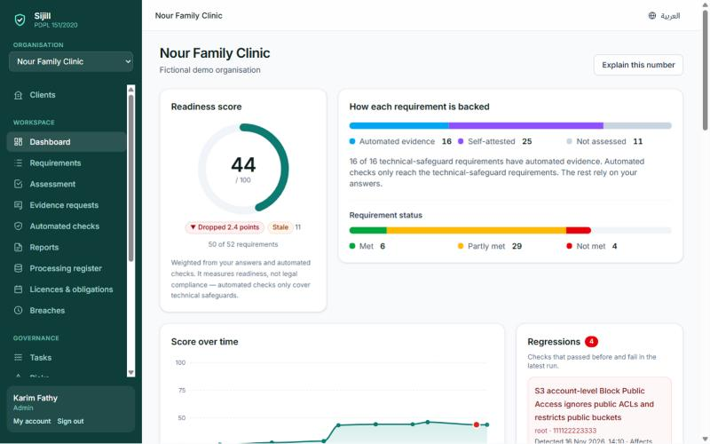
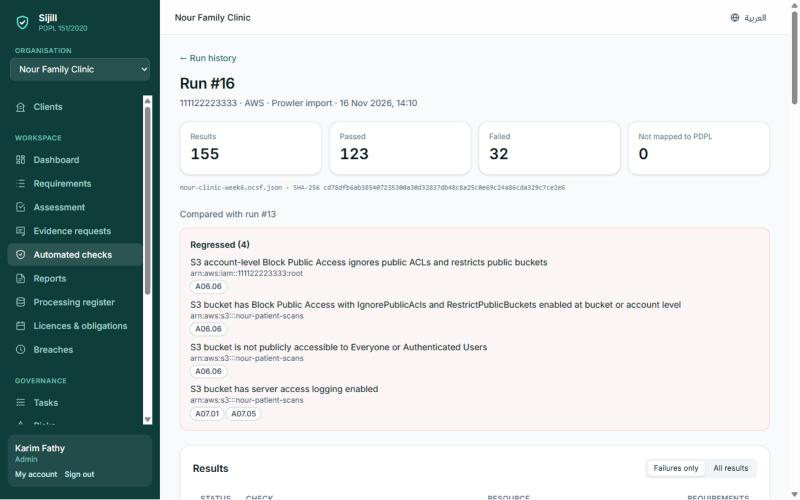
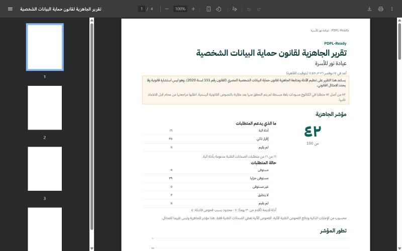
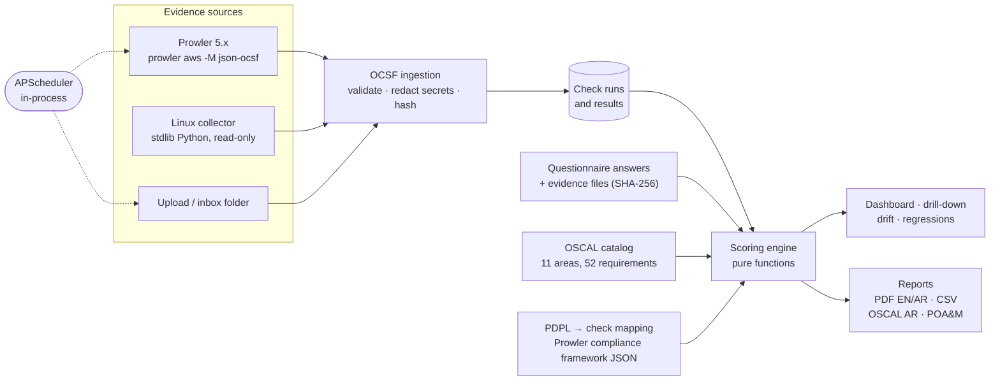

# PDPL-Ready

**Open-source, self-hosted readiness tracking for Egypt's Personal Data Protection Law (Law No. 151 of 2020).**
Assess an organisation against the law, back the technical part with automated evidence from Prowler and Linux
hosts, watch the score over time, catch regressions, and hand management a report, in English or Arabic.

> PDPL-Ready helps you organise evidence and track readiness. It is **not legal advice** and does not determine legal
> compliance. The requirement catalog is plain-language drafting that has **not yet been verified** against the official
> legal texts. Every unverified item is marked in the app and listed in [docs/LEGAL-REVIEW.md](docs/LEGAL-REVIEW.md).



## Why it exists

Egypt's data protection regime has moved from principle to enforcement. Controllers and processors are expected to
appoint a Data Protection Officer, hold licences and permits for some activities, keep records of processing, and
report breaches to the regulator quickly. Commercial GRC platforms cost more than most small organisations can spend
and centre on SOC 2, ISO 27001 and GDPR, so in practice compliance lives in spreadsheets and PDF checklists, with no
proof that the technical controls exist or still hold.

**Who it is for**

- **Compliance consultants and DPOs serving several small organisations**: clinics, schools, ed-tech companies,
  startups. One install per client keeps each organisation's data separate (`-DataDir`).
- **In-house IT and security teams** who have to show that the safeguards are actually in place.

## What it does

| | Capability | State |
|---|---|---|
| 1 | **PDPL catalog in OSCAL**: 11 assessment areas, 52 requirements, English and Arabic, each with a plain-language question and guidance | Working |
| 2 | **Technical evidence engine**: imports Prowler JSON-OCSF findings and output from a dependency-free Linux collector; 129 Prowler AWS checks and 12 Linux checks mapped to 16 technical requirements; every result hashed and timestamped | Working; AWS evidence in this repo is synthetic (no AWS account was scanned) |
| 3 | **Scoring with drill-down**: weighted readiness score per area and overall; failing checks cap self-attested answers; staleness flags; every number explains itself down to the failing resource | Working |
| 4 | **Posture and drift**: scheduled collection, run history, run-to-run comparison, regression detection, score-over-time chart | Working |
| 5 | **Reporting**: readiness report and gap list as PDF (English and shaped right-to-left Arabic), CSV, OSCAL assessment results and POA&M | Working |
| 6 | **Assessment workflow**: answer area by area, attach evidence | In progress |
| 7 | Processing register, licensing tracker and applicability screener, breach clock | Planned (stretch) |

Everything runs in English and Arabic with full right-to-left layout, behind local accounts with four roles
(Admin, DPO, IT/Security, read-only Auditor) enforced on the server, and an append-only, hash-chained audit log.

## Screenshots

All data below is the fictional demo clinic that `scripts/start.ps1` seeds.

| | |
|---|---|
|  |  |
| **Drift.** The latest scan dipped the score; the red point and the list show why. | **Every number explains itself.** The DPO answered "Met"; three failing checks cap it at "Partly met". |
|  |  |
| **Run comparison.** Resource-by-resource diff against the previous scan of the same account. | **Arabic, right to left.** Mirrored layout, Arabic-Indic digits, reversed time axis. |
|  |  |
| **Reports.** PDF, CSV and OSCAL, each with the not-legal-advice notice. | **Arabic PDF.** Shaped and reordered with pure-Python packages, no system fonts. |

## Architecture



- **Backend**: Python 3.12, FastAPI, SQLAlchemy 2 + Alembic, Pydantic, APScheduler. SQLite by default; Postgres via
  `DATABASE_URL` (exercised in CI).
- **Frontend**: React 19, TypeScript, Vite, Tailwind CSS 4, Recharts, i18next. FastAPI serves the built UI, so the app
  is one process on one port.
- **Data contract**: OSCAL 1.1.3 for the catalog, assessment results and POA&M, validated against the official NIST
  JSON schemas vendored in `backend/app/oscal/schemas/`.

## How the PDPL-to-check mapping works

The law's requirements live in [`catalog/pdpl-catalog.json`](catalog/pdpl-catalog.json), an OSCAL catalog with one
group per assessment area and one control per requirement. Each control carries its Arabic text, a weight (1-5),
whether it is a technical or organisational requirement, and `verified=false` / `source-status=needed` until a lawyer
reviews it.

The technical requirements are mapped to automated checks in
[`compliance/prowler/pdpl_egypt_aws.json`](compliance/prowler/pdpl_egypt_aws.json), written as a **Prowler compliance
framework** so it can be contributed upstream (Prowler would then report on PDPL directly). The format was read from
the Prowler 5.50.0 package itself, not written from memory, and the file loads with Prowler's own
`load_compliance_framework`. Every check ID is verified by a test against a committed snapshot of Prowler 5.50.0's
678 AWS checks, and again against a live Prowler install in CI.

Prowler has no Linux host provider, so [`collectors/linux/pdpl_linux_collector.py`](collectors/linux/pdpl_linux_collector.py)
fills the gap: one file, Python 3.6+ standard library only, read-only (a test parses its source and fails if it ever
runs a command outside an allow-list of read-only invocations). It checks disk encryption, SSH configuration, auditd and
its rules, log retention, time sync, the host firewall, pending security updates, automatic updates and permissions on
sensitive files, and prints findings in the same OCSF shape as Prowler. Its mapping
([`compliance/linux/pdpl_egypt_linux.json`](compliance/linux/pdpl_egypt_linux.json)) uses the same framework schema.

```
sudo python3 pdpl_linux_collector.py -o $(hostname).ocsf.json   # then import the file, or drop it in the inbox
```

| Technical requirement | AWS checks | Linux checks |
|---|---|---|
| A05.03 Retention periods enforced | 1 | – |
| A05.04 Backups protected and tested | 9 | – |
| A06.01 Encryption at rest | 15 | 1 |
| A06.02 Encryption in transit | 11 | 1 |
| A06.03 Key management | 5 | – |
| A06.04 Least privilege | 10 | – |
| A06.05 Strong authentication | 6 | 1 |
| A06.06 No public exposure of data stores | 19 | – |
| A06.07 Network protection | 8 | 1 |
| A06.08 Patching and vulnerability management | 8 | 2 |
| A06.09 Host hardening | 3 | 2 |
| A07.01 Audit logging enabled | 8 | 2 |
| A07.02 Log retention and protection | 7 | 2 |
| A07.03 Threat detection | 7 | – |
| A07.04 Security alerting | 10 | – |
| A07.05 Access to personal data is traceable | 4 | – |

## How scoring works

Each requirement ends up **met**, **partly met**, **not met**, **not applicable** or **not assessed**:

1. A self-attested answer is used as given, **except that a requirement backed by automated checks cannot score above
   "partly met" while any mapped check is failing**, whatever the answer says.
2. Without an answer, automated results decide: all checks passing → met; some failing → partly met; all failing → not met.
   A check fails if any resource fails it (one public bucket fails "no public buckets").
3. "Not applicable" is ignored while a mapped check fails; the systems evidently exist.
4. Evidence older than a configurable age (30 days by default) is flagged **stale**. It is shown, not scored.
5. Met = 1, partly met = 0.5, not met = 0, **not assessed = 0**; not applicable is excluded. Area and overall scores
   are weight-averaged over requirements.

The dashboard always shows how many requirements are backed by **automated evidence**, **self-attested** or **not
assessed**, because automated checks only reach the technical-safeguard part of the law. That is why the headline
number is a *readiness* score and is never presented as legal compliance. Click any area, requirement or regression
to see the answer, each mapped check and each failing resource behind the number. The rules are pure functions in
[`backend/app/scoring.py`](backend/app/scoring.py) with their own unit tests.

## How OSCAL is used

| Document | Endpoint | Contents |
|---|---|---|
| Catalog | `GET /api/catalog/oscal` | The 52 requirements; Arabic in a namespaced part/prop. Admins can import a reviewed catalog (schema-validated first). |
| Assessment results | `GET /api/reports/oscal/assessment-results` | One observation per automated check per monitored system, with every resource result and its SHA-256 as relevant evidence; one observation per self-attested answer; one finding per assessed requirement targeting its assessment objective. |
| Plan of action and milestones | `GET /api/reports/oscal/poam` | One POA&M item per gap, linked to its finding. |

Exports are validated against the official NIST OSCAL 1.1.3 JSON schemas in the test suite (the schemas use
`\p{L}` patterns, so validation runs with the `regex` package). Round trips are tested: catalog → OSCAL → catalog is
lossless, and an exported assessment-results document imported into an empty install reproduces the same automated
statuses and findings (`POST /api/reports/oscal/assessment-results/import`), so a consultant can carry evidence between
installs.

## Evidence integrity and security

- Every findings file, every individual result and every uploaded evidence file is stored with a **SHA-256** hash and a
  UTC timestamp; downloads re-verify the hash.
- The **audit log** is append-only, enforced three ways: ORM events, database triggers (SQLite and Postgres) and a hash
  chain that `GET /api/audit/verify` recomputes.
- **Cloud credentials are never stored.** The Prowler adapter only passes an AWS profile name or role ARN from the
  server environment. Anything in a findings file that looks like an access key, secret key, session token or private
  key is redacted before storage.
- Argon2 password hashing, signed HttpOnly SameSite=Strict session cookies, a custom header on every write (CSRF),
  login throttling, role checks on every endpoint, strict security headers, and upload type, size and magic-byte checks.

## Run it

Requirements: Windows with PowerShell, Python 3.12 (64-bit) and Node 24. Everything else installs project-locally.

```powershell
./scripts/start.ps1
```

This creates `.venv`, installs dependencies, builds the UI, migrates the database, seeds the demo clinic on first run
and serves everything at <http://127.0.0.1:8000>. Demo accounts (password `pdpl-demo-2026`):

| User | Role | Can |
|---|---|---|
| `admin` | Admin | everything, including users and settings |
| `dpo` | DPO | answer the assessment, upload evidence, manage records |
| `it` | IT / Security | import findings, run collection, upload evidence |
| `auditor` | Auditor | read everything, download reports, change nothing |

Other options:

```powershell
./scripts/start.ps1 -NoDemo                     # empty install: create the first admin in the browser
./scripts/start.ps1 -DataDir D:\clients\acme    # one install per client organisation
./scripts/start.ps1 -ResetDemo                  # wipe and re-seed the demo
./scripts/dev.ps1                               # API with auto-reload + Vite dev server on :5173
```

Configuration is by environment variable (`PDPL_` prefix), for example `PDPL_EVIDENCE_STALE_DAYS`,
`PDPL_COLLECT_INTERVAL_HOURS`, `PDPL_AWS_PROFILE`, `PDPL_BREACH_REGULATOR_HOURS` and `DATABASE_URL`. Legal durations are
configuration with defaults, never constants; see [docs/LEGAL-REVIEW.md](docs/LEGAL-REVIEW.md).

A `Dockerfile` and `docker-compose.yml` are included (`PDPL_SEED_DEMO=1` seeds the demo). They are built in CI but were
not run on the development machine.

### Collecting evidence

- **Prowler (AWS)**: install Prowler where PDPL-Ready runs and set `PDPL_AWS_PROFILE` or `PDPL_AWS_ROLE_ARN`; the
  scheduler then runs `prowler aws --checks <mapped checks> -M json-ocsf` and imports the result. Or run Prowler
  anywhere and import its `.ocsf.json` file.
- **Linux**: run the collector on each host and import the file, or copy it into the inbox folder shown on the
  *Automated checks → Collection* tab.
- **Try it without any infrastructure**: import `fixtures/prowler/nour-clinic-week6.ocsf.json` or
  `fixtures/linux-output/clinic-web-01.ocsf.json`.

## Tests

| Suite | Count | What it covers |
|---|---|---|
| Backend (pytest) | 123 passed, 2 skipped | auth and every role, audit chain, catalog schema and round trip, scoring rules, ingestion edge cases (malformed, wrong class, oversized, wrong type, duplicate), redaction, regressions, adapters, reports, OSCAL validity and round trip, demo story |
| Linux collector | included above | replays recorded fictional hosts; read-only command guarantee |
| Frontend (vitest) | 14 passed | sign-in, roles, Arabic RTL and digits, dashboard, drill-down, filters, import errors |

The two skipped tests need a live Prowler install, which the Windows path limit prevented here (see
[docs/DECISIONS.md](docs/DECISIONS.md)); CI's `prowler-mapping` job runs them on Linux. Postgres tests and the Docker
build also run only in CI.

```powershell
cd backend; ..\.venv\Scripts\python -m pytest
cd frontend; npm test
```

Measured on the development machine with the demo data: seeding the demo takes about 2 seconds; the readiness PDF
renders in 0.04 s (English) and 0.19 s (Arabic, first render including font loading); the OSCAL assessment-results
export holds 153 observations and 41 findings.

## Project layout

```
backend/app/          FastAPI app: auth, catalog, evidence engine, scoring, posture, reports, scheduler
backend/alembic/      database migrations (append-only audit triggers included)
catalog/              the PDPL OSCAL catalog
compliance/           PDPL mapping as a Prowler framework (AWS) and the Linux mapping; Prowler check snapshot
collectors/linux/     the read-only Linux collector
fixtures/             recorded fictional hosts and synthetic Prowler findings
frontend/             React + TypeScript UI
scripts/              start, dev, fixture, font and legal-review generators
docs/                 DECISIONS, PROGRESS, LEGAL-REVIEW, screenshots
```

## Legal accuracy

Invented legal detail is worse than a visible gap, so:

- No article numbers, decree clauses, fees or penalties appear anywhere (a test enforces it for the catalog).
- Every requirement is marked unverified with "source needed" until a lawyer reviews it; reviewing means editing the
  catalog (or importing a reviewed one) and citing the source.
- Deadlines and durations are configuration with defaults.
- Licences and permits are described as "likely required", never "required".
- The UI footer and every report carry the not-legal-advice notice.

## License

MIT, see [LICENSE](LICENSE). Bundled schemas, fonts and Prowler metadata keep their own licences.
